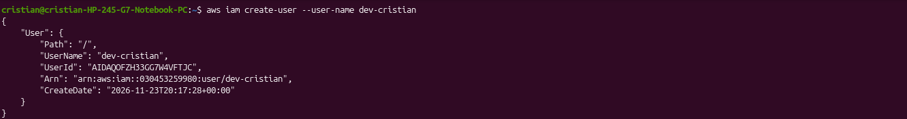
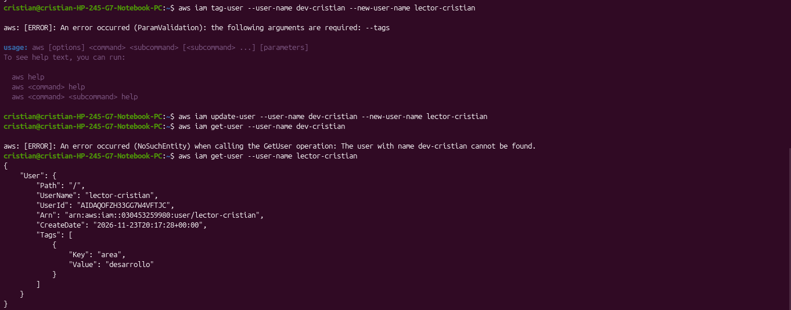
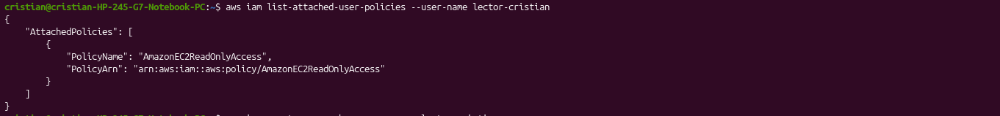
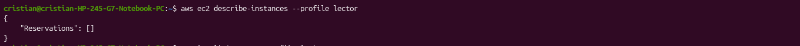
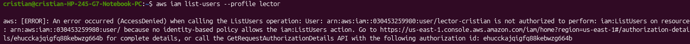
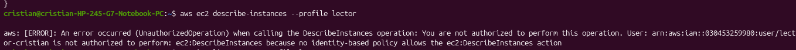
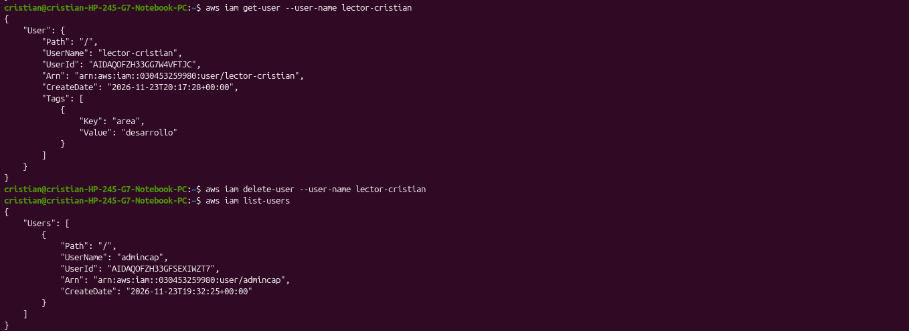

# Evidencia: ciclo de vida de un usuario IAM

- **Estudiante:** Cristian
- **Fecha:** 2026-11-23
- **Usuario administrador:** `admincap`
- **Usuario de la actividad:** `dev-cristian` → `lector-cristian`
- **Región del perfil `lector`:** `us-east-2`

> Esta evidencia no incluye la clave secreta de la llave de acceso.

---

## Paso 3: Datos del usuario y su ARN

Se creó el usuario `dev-cristian`. Su ARN es `arn:aws:iam::030453259980:user/dev-cristian` y todavía no tiene ninguna política adjunta.

---

## Paso 6: Usuario renombrado con su etiqueta

Después de agregar la etiqueta `area=desarrollo` y renombrar el usuario a `lector-cristian`:

- `get-user` con el nombre viejo devuelve `NoSuchEntity`.
- Con el nombre nuevo, el usuario conserva la etiqueta y el mismo `UserId` (`AIDAQOFZH33GG7W4VFTJC`), pero el ARN cambió a `arn:aws:iam::030453259980:user/lector-cristian`.

En la captura también aparece un primer intento con `tag-user --new-user-name`, que falló con `ParamValidation` porque el comando correcto para renombrar es `update-user`.

---

## Paso 8: Política adjunta

El usuario `lector-cristian` tiene adjunta la política administrada `AmazonEC2ReadOnlyAccess`.

---

## Paso 12: Acción permitida

`aws ec2 describe-instances --profile lector` responde sin error, porque la política permite consultar EC2.

---

## Paso 13: Acción no permitida

`aws iam list-users --profile lector` devuelve `AccessDenied`, porque la política no da permisos sobre IAM.

---

## Paso 15: Acción bloqueada después de quitar la política

Después de quitarle `AmazonEC2ReadOnlyAccess` con el usuario administrador, el mismo `describe-instances` que antes funcionaba ahora es denegado.

---

## Paso 19: Usuario eliminado

Tras borrar la llave de acceso y confirmar que no quedaban políticas, se borró el usuario. `list-users` ya no muestra `lector-cristian`.

---

## Preguntas de reflexión

> Borrador: revísalo y ajústalo con tus palabras antes de entregar.

**1. ¿Qué podía hacer el usuario justo después de crearlo, antes de adjuntarle una política? ¿Por qué?**

Nada. En IAM todo está negado por defecto: un usuario nuevo es solo una identidad, sin políticas que le permitan ninguna acción. Además, tampoco tenía contraseña ni llaves de acceso, así que ni siquiera podía iniciar sesión.

**2. En el error del paso 13, ¿qué tres datos te dice el mensaje?**

- **Quién** intentó la acción: el ARN del usuario (`arn:aws:iam::030453259980:user/lector-cristian`).
- **Qué acción** intentó: `iam:ListUsers`.
- **Sobre qué recurso** y **por qué** se negó: el recurso de IAM de la cuenta, porque ninguna política basada en identidad le permite esa acción.

**3. ¿Por qué cambió el `Arn` al renombrar el usuario?**

Porque el ARN se construye con el nombre del usuario (`...:user/<nombre>`). Al cambiar el nombre cambia el ARN. El `UserId` sí se mantiene, porque es el identificador interno único del usuario.

**4. ¿Por qué AWS obliga a borrar las llaves antes de borrar el usuario?**

Para que no queden credenciales activas huérfanas y para que el borrado sea intencional. Si el usuario tiene llaves, políticas u otros elementos asociados, IAM responde `DeleteConflict`; así uno revisa y limpia todo lo que el usuario podía usar antes de eliminarlo.

**5. ¿Qué pasaría si le hubieras dado `AdministratorAccess` en vez de solo lectura? ¿En qué caso real estaría justificado?**

El usuario podría hacer cualquier cosa en la cuenta: crear y borrar recursos, generar costos, crear otros usuarios o borrar al administrador. Si sus llaves se filtraran, el atacante tendría control total. Solo se justifica para el usuario administrador de la cuenta (por ejemplo, la persona responsable de la infraestructura), nunca para un usuario que solo necesita consultar.

---

## Criterios de evaluación

| Criterio | Cumple |
|---|---|
| El usuario fue creado, editado y eliminado en el orden correcto | ✅|
| Se evidencia una acción permitida y una denegada |✅|
| La evidencia no expone ninguna clave secreta | ✅ |
| No quedaron usuarios ni llaves de la actividad en la cuenta |✅ |
| Las preguntas están respondidas con sus propias palabras | ✅|
