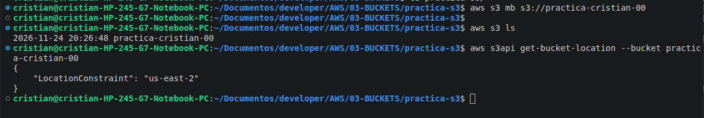
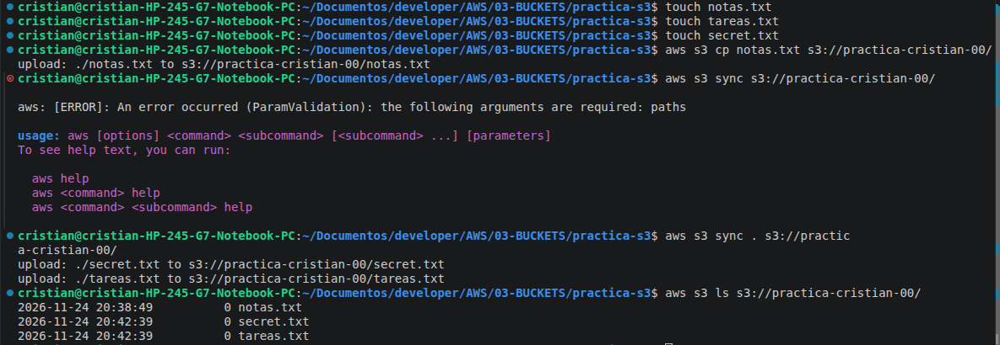
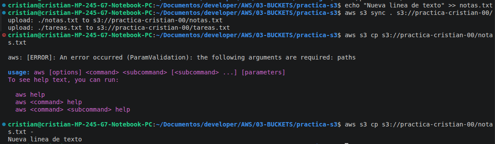
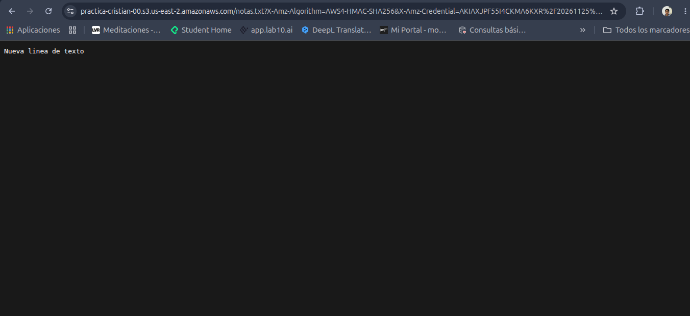
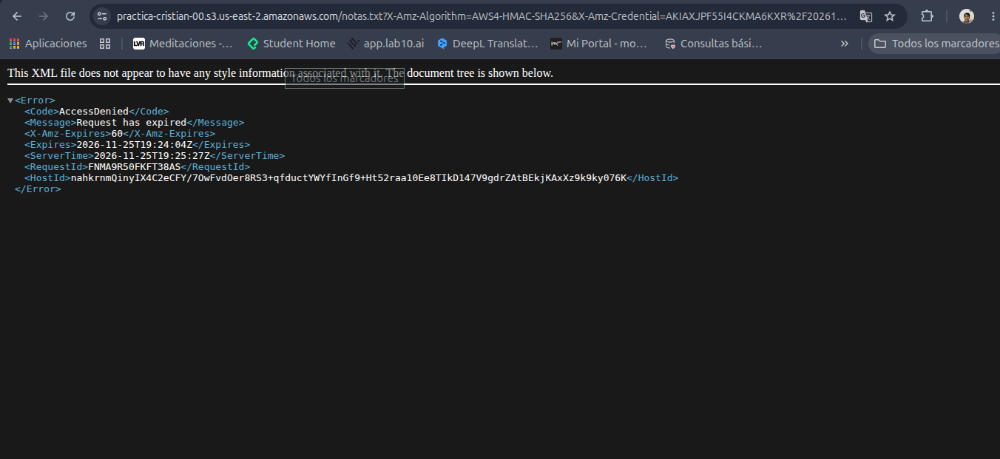
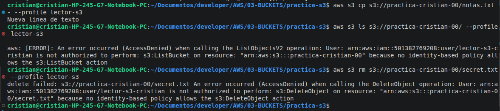
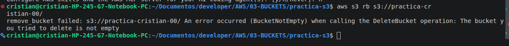
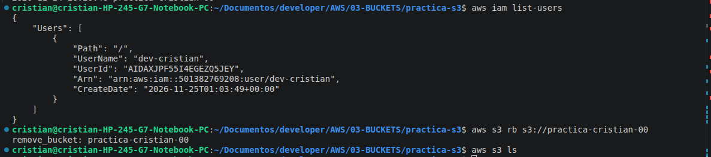

# Evidencia: ciclo de vida de un bucket en S3

- **Estudiante:** Cristian
- **Fecha:** 2026-11-25
- **Bucket de la actividad:** `practica-cristian-00`
- **Región:** `us-east-2`
- **Usuario lector:** `lector-s3-cristian` (perfil `lector-s3`)

> Esta evidencia no incluye la clave secreta de la llave de acceso.

---

## Paso 3: Bucket creado y su región

Se creó el bucket con `aws s3 mb`. `aws s3 ls` muestra que existe, y `get-bucket-location` confirma que está en `us-east-2`.

---

## Paso 7: Contenido del bucket

Se subió `notas.txt` con `cp`, y `secret.txt` y `tareas.txt` con un solo `sync`. El bucket queda con los tres objetos.

En la captura también aparece un primer intento de `aws s3 sync s3://practica-cristian-00/`. Falló con `ParamValidation` porque `sync` necesita dos rutas: origen y destino (`aws s3 sync . s3://practica-cristian-00/`).

---

## Paso 13: Contenido de `notas.txt` modificado

Se agregó una línea a `notas.txt` en local y se volvió a subir. Al mostrarlo desde el bucket con `aws s3 cp ... -` aparece `Nueva linea de texto`, así que el objeto se sobrescribió.

En la captura también aparece un primer intento sin el `-` final. Falló porque `cp` necesita un destino, y el `-` le dice que el destino es la terminal.

---

## Paso 16: Enlace temporal funcionando y luego expirado

Se generó un enlace temporal de 60 segundos con `aws s3 presign`.

Antes del minuto, el enlace abre el archivo en el navegador:

Después de que pasó el minuto, el mismo enlace devuelve `AccessDenied` con el mensaje `Request has expired`. El bucket nunca dejó de ser privado.

---

## Pasos 21, 22 y 23: Una acción permitida y dos denegadas

El usuario `lector-s3-cristian` tiene una política en línea que solo permite `s3:GetObject` sobre `arn:aws:s3:::practica-cristian-00/*`. Con el perfil `lector-s3`:

- **Paso 21:** leer `notas.txt` funciona.
- **Paso 22:** listar el bucket devuelve `AccessDenied`, porque no tiene `s3:ListBucket`.
- **Paso 23:** borrar `secret.txt` devuelve `AccessDenied`, porque no tiene `s3:DeleteObject`.

---

## Paso 24: Borrar el bucket sin vaciarlo

`aws s3 rb` devuelve `BucketNotEmpty`, porque S3 no deja borrar un bucket que todavía tiene objetos.

---

## Paso 29: Nada quedó de la actividad

- `aws iam list-users` ya no muestra `lector-s3-cristian`. El único usuario que queda es `dev-cristian`, que no es de esta actividad.
- `aws s3 rb` borra el bucket vacío (`remove_bucket: practica-cristian-00`), y después `aws s3 ls` no devuelve nada.

---

## Preguntas de reflexión

> Borrador: revísalo y ajústalo con tus palabras antes de entregar.

**1. ¿Por qué el nombre de tu bucket tuvo que ser distinto al de tus compañeros si cada uno tiene su propia cuenta?**

Porque los nombres de bucket son globales: no puede haber dos buckets con el mismo nombre en todo AWS, aunque estén en cuentas o regiones distintas. El nombre forma parte de la dirección del bucket (`practica-cristian-00.s3.us-east-2.amazonaws.com`), y esa dirección tiene que ser única en internet.

**2. El usuario del paso 21 pudo leer un archivo, pero en el paso 22 no pudo ver la lista. ¿Qué acción le faltaba en la política?**

Le faltaba la acción `s3:ListBucket`. Su política solo tenía `s3:GetObject`, que sirve para leer un archivo si sabes su nombre, pero no para ver la lista de archivos del bucket. Listar es un permiso aparte, y el error del paso 22 lo dice: `not authorized to perform: s3:ListBucket`.

**3. En la política, ¿qué significa el `/*` al final del `Resource`? ¿Qué pasaría si se quitara?**

`/*` significa "todos los objetos dentro del bucket". Si se quitara, el `Resource` apuntaría al bucket y no a sus objetos. Como `s3:GetObject` se aplica a objetos, la política no coincidiría con nada y el usuario ya no podría leer ningún archivo: el paso 21 también daría `AccessDenied`.

**4. ¿En qué se diferencia compartir un archivo con un enlace temporal de hacer público el bucket?**

- **Enlace temporal:** da acceso a **un solo archivo**, por un **tiempo limitado** (60 segundos en la actividad), y solo a quien tenga el enlace. El bucket sigue privado, y al expirar el enlace deja de funcionar.
- **Bucket público:** **cualquier persona** en internet puede leer **todos los objetos**, **sin límite de tiempo**, hasta que alguien lo vuelva a cerrar.

**5. Según el modelo de responsabilidad compartida, si alguien deja un bucket público con datos de clientes, ¿de quién es la responsabilidad?**

Del cliente, es decir, de quien usa la cuenta. AWS es responsable de la seguridad **de** la nube: centros de datos, hardware y el servicio S3. El cliente es responsable de la seguridad **en** la nube: sus datos, sus permisos y cómo configura sus buckets. Los buckets nacen privados y con el bloqueo de acceso público activado, así que hacerlo público es una decisión de configuración del cliente.

---

## Criterios de evaluación

| Criterio | Cumple |
|---|---|
| El bucket fue creado, usado y eliminado en el orden correcto | ✅ |
| Se evidencia el enlace temporal funcionando y luego expirado | ✅ |
| Se evidencia una acción permitida y dos denegadas con el usuario lector | ✅ |
| La política solo permite `s3:GetObject` sobre su propio bucket | ✅ |
| La evidencia no expone ninguna clave secreta | ✅ |
| No quedaron buckets, usuarios ni llaves de la actividad en la cuenta | ✅ |
