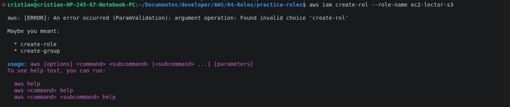
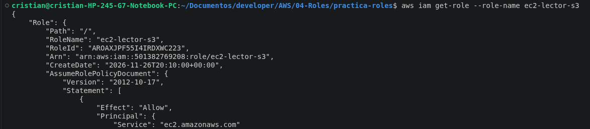
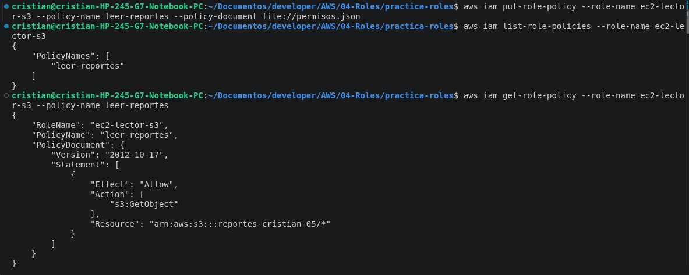
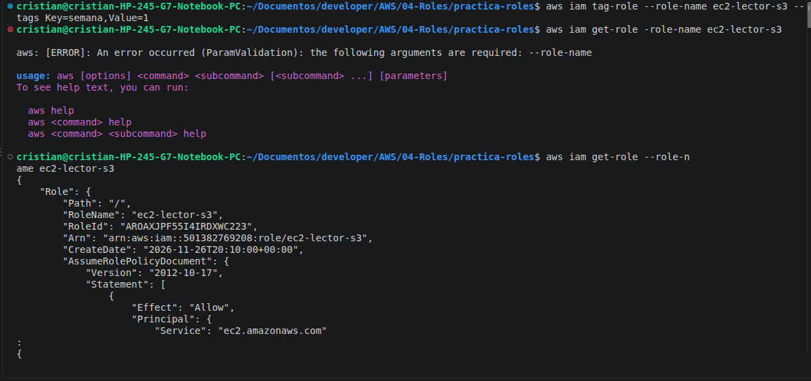
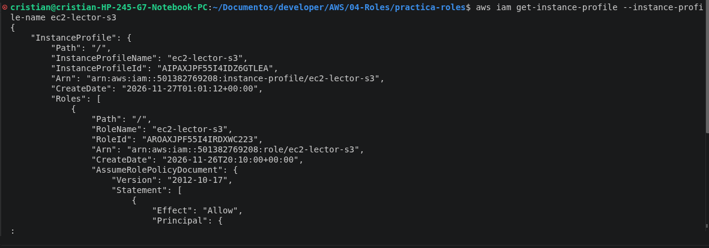
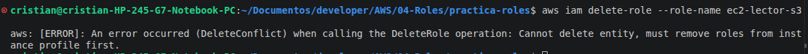

# Evidencia: un rol para tu instancia EC2

- **Estudiante:** Cristian
- **Fecha:** 2026-11-26
- **Región:** `us-east-2`
- **Bucket:** `reportes-cristian-05` (con `reporte.txt`)
- **Rol:** `ec2-lector-s3`
- **Perfil de instancia:** `ec2-lector-s3`

---

## Las dos políticas

**`confianza.json`**: solo el servicio EC2 puede asumir el rol.

```json
{
  "Version": "2012-10-17",
  "Statement": [{
    "Effect": "Allow",
    "Principal": { "Service": "ec2.amazonaws.com" },
    "Action": "sts:AssumeRole"
  }]
}
```

**`permisos.json`**: solo deja leer objetos de mi bucket.

```json
{
  "Version": "2012-10-17",
  "Statement": [{
    "Effect": "Allow",
    "Action": ["s3:GetObject"],
    "Resource": "arn:aws:s3:::reportes-cristian-05/*"
  }]
}
```

---

## Paso 7: Crear el rol sin política de confianza

AWS no deja crear el rol y pide `--assume-role-policy-document`. Un rol no puede existir sin decir quién lo puede usar.



---

## Paso 9: Datos del rol

El rol quedó creado. Su ARN es `arn:aws:iam::501382769208:role/ec2-lector-s3`, y en `AssumeRolePolicyDocument` aparece la política de confianza con `ec2.amazonaws.com`.



---

## Paso 13: Política `leer-reportes`

Se agregó la política en línea con `put-role-policy`, ya aparece en la lista y desde AWS muestra una sola acción, `s3:GetObject`, sobre `reportes-cristian-05/*`.



---

## Paso 16: Descripción y etiqueta

El rol ahora tiene la descripción `Rol para que EC2 lea reportes` y la etiqueta `semana = 1`.



---

## Paso 19: Perfil de instancia con el rol

El perfil `ec2-lector-s3` tiene adentro el rol `ec2-lector-s3`. Se llaman igual, pero el ARN del perfil dice `instance-profile/` y el del rol dice `role/`.



---

## Paso 20: Intentar borrar el rol

Falla con `DeleteConflict`: primero hay que sacar el rol del perfil de instancia. El rol sigue existiendo.



---

## Preguntas de reflexión

**1. ¿Qué diferencia hay entre la política de confianza y la política de permisos? ¿Qué pasaría si el rol tuviera solo una de las dos?**

La de confianza dice **quién** puede usar el rol (aquí, EC2). La de permisos dice **qué** puede hacer quien lo use (leer archivos de mi bucket). Si solo tuviera la de confianza, la EC2 podría ponerse el rol, pero no podría hacer nada. Y sin la de confianza el rol ni siquiera se puede crear, como se vio en el paso 7.

**2. ¿Por qué es más seguro que la instancia use un rol en vez de guardar una llave de acceso con `aws configure`?**

Porque la llave queda guardada en un archivo dentro de la instancia y no vence: si alguien entra a la máquina, se la roba y la puede usar desde donde quiera. Con el rol, AWS le da a la instancia credenciales temporales que se renuevan solas, y no hay ninguna llave guardada que se pueda robar.

**3. Con la política `leer-reportes`, ¿la instancia podrá listar el contenido del bucket? ¿Y borrar `reporte.txt`?**

No puede hacer ninguna de las dos. Solo tiene `s3:GetObject`, que sirve para leer un archivo si ya sabes cómo se llama. Para listar le faltaría `s3:ListBucket` y para borrar le faltaría `s3:DeleteObject`. Lo que no está permitido, AWS lo niega.

**4. En el error del paso 20, ¿qué le falta por hacer antes de poder borrar el rol?**

Sacar el rol del perfil de instancia, que es lo que pide el error. Además hay que borrarle la política en línea `leer-reportes`. Recién con el rol "suelto" y sin políticas, AWS deja borrarlo.

**5. Si mañana la instancia también necesita subir archivos al bucket, ¿qué cambiarías y en cuál de los dos archivos?**

Agregaría `s3:PutObject` a la lista de acciones en `permisos.json` y volvería a correr `put-role-policy` para actualizarla en AWS. `confianza.json` no se toca, porque quién usa el rol sigue siendo el mismo: EC2.

---

## Criterios de evaluación

| Criterio | Cumple |
|---|---|
| La política de confianza permite asumir el rol solo al servicio EC2 | ✅ |
| La política de permisos solo permite `s3:GetObject` sobre su propio bucket | ✅ |
| El rol tiene descripción y etiqueta | ✅ |
| El perfil de instancia contiene el rol | ✅ |
| Se evidencian los dos errores provocados (pasos 7 y 20) | ✅ |
| El bucket, el rol y el perfil quedaron creados para la práctica de EC2 | ✅ |
| Las preguntas están respondidas con sus propias palabras | ✅ |
